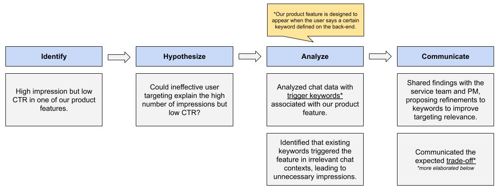

# Feature Targeting Improvement Proposal

### Team's Pain Point

1. The team needed to identify opportunities to improve user experience based on newly developed performance metrics (*connection to OKR dashboard work).
2. Analysis of feature-level performance revealed that a chat feature was being exposed to users who were unlikely to engage with it, contributing to low click-through rates (CTR).

### My Role

Identified ineffective user targeting through performance metrics analysis and drafted a feature targeting improvement proposal to address unnecessary feature exposure and low CTR.

### Approach & Rationale

  
   
  <em>Figure 1. Data-Driven Feature Targeting Improvement Process .</em>

1. **Identify performance issues**: Analyzed the performance metrics I developed to identify features with opportunities for improvement.
2. **Investigate user targeting**:
   - Extracted chat room records associated with the existing keyword.
   - Identified cases where the feature was triggered in irrelevant contexts, resulting in unnecessary feature exposure.
   - Hypothesised that irrelevant triggering could contribute to low CTR.
3. **Draft a targeting improvement proposal**:
   - Proposed that the relevant service team refine the keywords to improve targeting accuracy.
   - Recommended reducing unnecessary feature exposure by aligning trigger conditions with relevant user contexts.
  

**Balancing CTR improvement with user experience**:
   - Recognized that more precise targeting would reduce total impressions, potentially increasing CTR simply by removing irrelevant exposures rather than generating more clicks.
   - Considered the trade-off between maximizing feature exposure and ensuring relevance to users.
   - Acknowledged that the reduction in impressions was an expected and acceptable trade-off, as the service team's primary objective was to improve user experience rather than maximize feature visibility.
   - Discussed with both the service team and the chat team how refined targeting could reduce impressions while potentially increasing CTR, aligning on the trade-off as an acceptable cost of improving user experience.

### Outcome

- Identified irrelevant feature triggers through chat data analysis and proposed refining keywords to improve targeting accuracy.
- Drafted a data-driven feature targeting improvement proposal to reduce unnecessary exposure and improve user engagement.
